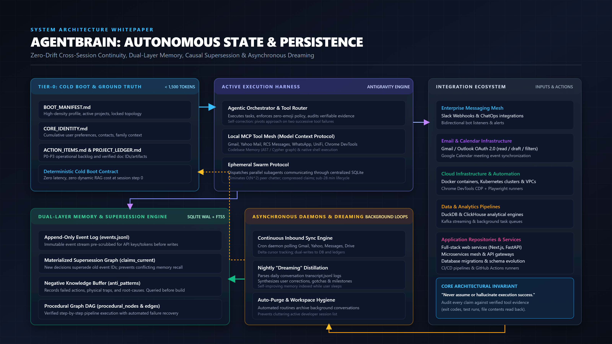

# AgentBrain: Persistent State & Memory Architecture for AI Agents

> A zero-drift, cross-session memory architecture and execution harness for autonomous AI coding agents (Antigravity, Claude Code, Cursor, Windsurf, Cline).



---

## The Problem: The Trilemma of Agent Context

Most AI coding assistants are amnesiacs. Every new conversation starts from tabula rasa:
1. **Token Tax:** Dumping 50,000 tokens of past chat transcripts burns context windows and causes hallucinations.
2. **Causal Supersession:** Semantic search (vector RAG) retrieves outdated chunks without temporal causality. If an architecture decision changed on Tuesday, the agent still recalls and acts on Monday's obsolete choice.
3. **Negative Knowledge:** Agents lack a negative memory buffer. Without explicit failure-mode tracking, they repeat the exact same broken patterns across sessions.

**AgentBrain solves this with a 4-layer persistent memory hierarchy.**

---

## The 4-Layer Architecture

```
[User Prompts & Outside World] 
         |
         v
+-------------------+      Background Sync
| Continuous Sync   | ---> (Email, Messages, Drive)
+-------------------+             |
         |                        v
         |              +-------------------+
         +------------> | Workspace Ledgers | <----+
                        | (BOOT_MANIFEST,   |      |
                        |  ACTION_ITEMS)    |      |
                                |                  |
      Cold Boot (0ms)           v                  |
   +------------------------------------+          |
   | Active Agent Session (Antigravity) |          |
   |   - Reads Manifest (<40 lines)     |          |
   |   - Checks Anti-Patterns           |          |
   |   - Walks Procedural Graph         |          |
   |   - Executes MCP Tools             |          |
   +------------------------------------+          |
                   |                               |
              Session Logs                         |
                   v                               |
   +------------------------------------+          |
   | Nightly Dream Sync (Distillation)  | ---------+
   |   - Parses conversation logs       |          |
   |   - Synthesizes decisions/gotchas  |          |
   |   - Upserts into SQLite memory.db  | ---------+
   +------------------------------------+
```

### Layer 1: Tier-0 Cold Boot (<1.5k Tokens)
Instead of dynamic RAG at session launch, the agent silently reads `BOOT_MANIFEST.md` at step 0.
- Less than 40 lines of high-density markdown.
- Contains the executive user profile, active project statuses, and locked architecture ground truth.
- Backed by domain ledgers: `CORE_IDENTITY.md`, `ACTION_ITEMS.md`, `PROJECT_LEDGER.md`, and `ANTI_PATTERNS.md`.
- **Cost:** ~1,200 tokens. **Latency:** 0ms.

### Layer 2: Dual-Layer Memory & Supersession Engine
- **Append-Only Event Log (`events.jsonl`):** Raw atomic observations and facts. Pre-scrubbed for API keys and bearer tokens before disk writes (`scrub_secrets.py`).
- **Derived SQLite FTS5 Database (`memory.db`):** WAL mode with 2, 3, 4 character prefix indexing for sub-millisecond keyword retrieval.
- **Materialized Supersession Graph:** Every decision carries `chain_id` and `parent_event_id`. When a decision updates, previous claims are marked `superseded`. Queries read from `claims_current WHERE verdict = 'active'`.
- **Negative Knowledge Buffer (`anti_patterns`):** Indexes problem contexts, flawed actions, root-cause failure modes, and verified alternatives. Checked before designing any technical approach.
- **Procedural Graph DAG (`procedural_nodes`, `procedural_edges`):** Multi-step execution pipelines with preconditions, verification criteria, and automatic failure recovery branches.

### Layer 3: Active Execution Harness & Tool Mesh
The agent connects directly to real-world infrastructure via the **Model Context Protocol (MCP)**:
- Shell execution & Git workflows.
- Chrome DevTools CDP / Playwright browser automation.
- Local email & messaging bridges (Gmail OAuth, IMAP, WhatsApp, RCS).
- AST Codebase knowledge graphs (`codebase-memory-mcp`).
- Ephemeral Swarm Protocol (`swarm_dispatch`): Parallel subagent pools communicating through SQLite graph state to prevent O(N^2) peer chatter.

### Layer 4: Asynchronous Loop (Dreaming & Continuous Sync)
- **Nightly Dreaming (`dream_sync.py`):** Background cron script that parses daily conversation transcripts (`transcript.jsonl`), distills emergent user preferences, tool gotchas, and architectural decisions, and indexes them into SQLite while the user sleeps.
- **Continuous Inbound Sync (`continuous_sync.py`):** Background daemon polling external APIs with delta cursors (`SYNC_CURSOR.json`), dual-writing state updates directly to `ACTION_ITEMS.md` and `memory.db`.
- **Workspace Hygiene:** Automated routines archive background conversations from the agent UI database so maintenance tasks never clutter the developer's workspace.

---

## Quickstart: 1-Shot Setup Prompt

You do not need to configure this manually. Copy the prompt from [`BOOTSTRAP_PROMPT.md`](BOOTSTRAP_PROMPT.md) and paste it into **Cursor**, **Claude Code**, **Windsurf**, or **Antigravity**.

The agent will autonomously:
1. Analyze your workspace.
2. Generate your customized `BOOT_MANIFEST.md` and ledgers.
3. Install the Python SQLite memory store and secret sanitizer.
4. Add the Tier-0 boot directive to your project's rules file (`.cursorrules`, `CLAUDE.md`, or `GEMINI.md`).

---

## Manual Installation

1. Copy the `agentbrain/` folder into your repository:
   ```bash
   cp -r agentbrain/ your-repo/.agentbrain/
   ```

2. Initialize the SQLite database:
   ```bash
   python .agentbrain/memory_store.py
   ```

3. Copy the templates into your workspace root:
   ```bash
   cp templates/BOOT_MANIFEST.md.template your-repo/BOOT_MANIFEST.md
   cp templates/CORE_IDENTITY.md.template your-repo/CORE_IDENTITY.md
   cp templates/ACTION_ITEMS.md.template your-repo/ACTION_ITEMS.md
   cp templates/PROJECT_LEDGER.md.template your-repo/PROJECT_LEDGER.md
   cp templates/ANTI_PATTERNS.md.template your-repo/ANTI_PATTERNS.md
   ```

4. Configure your MCP server in `mcp_config.json`:
   ```json
   {
     "mcpServers": {
       "agentbrain-memory": {
         "command": "python",
         "args": [".agentbrain/mcp_server.py"]
       }
     }
   }
   ```

---

## Python API Usage

```python
from agentbrain import memory_store

# 1. Initialize the database
memory_store.init_db()

# 2. Record an architectural decision with supersession tracking
ev1 = memory_store.record_decision(
    domain="database",
    decision="Use SQLite with WAL mode for all local state storage",
    rationale="Zero network latency, serverless portability, single-file durability"
)

# 3. Later, supersede the decision if requirements change
ev2 = memory_store.record_decision(
    domain="database",
    decision="Use DuckDB for high-throughput OLAP analytics, keep SQLite for graph state",
    supersedes_event_id=ev1["event_id"]
)

# 4. Check negative knowledge before designing code
traps = memory_store.check_anti_patterns("concatenating sql strings")

# 5. Query active memory
results = memory_store.query_memory("database storage")
```

---

## License

MIT License. Open source for the AI engineering community.
